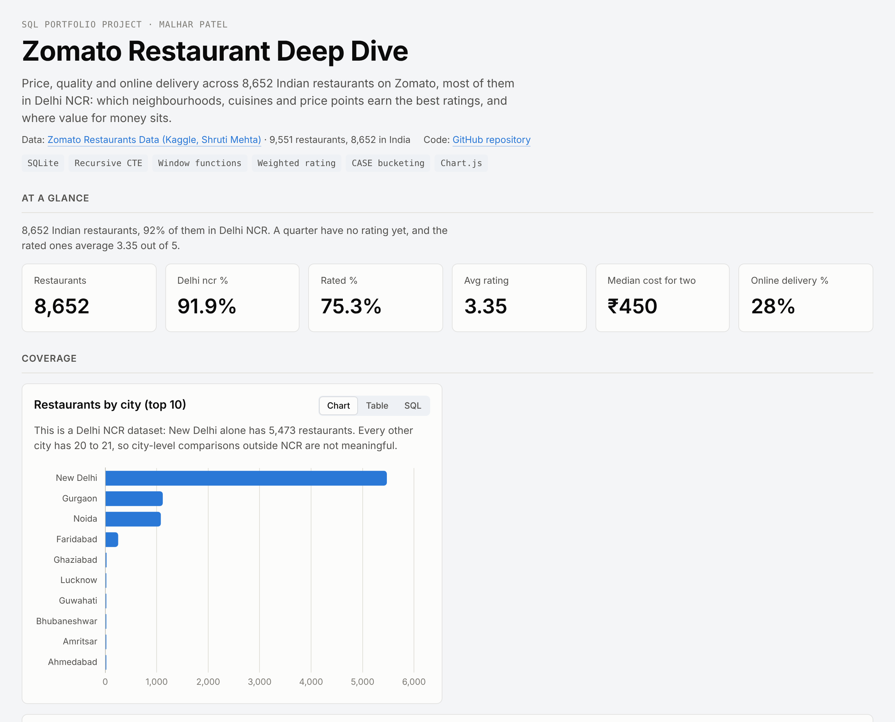
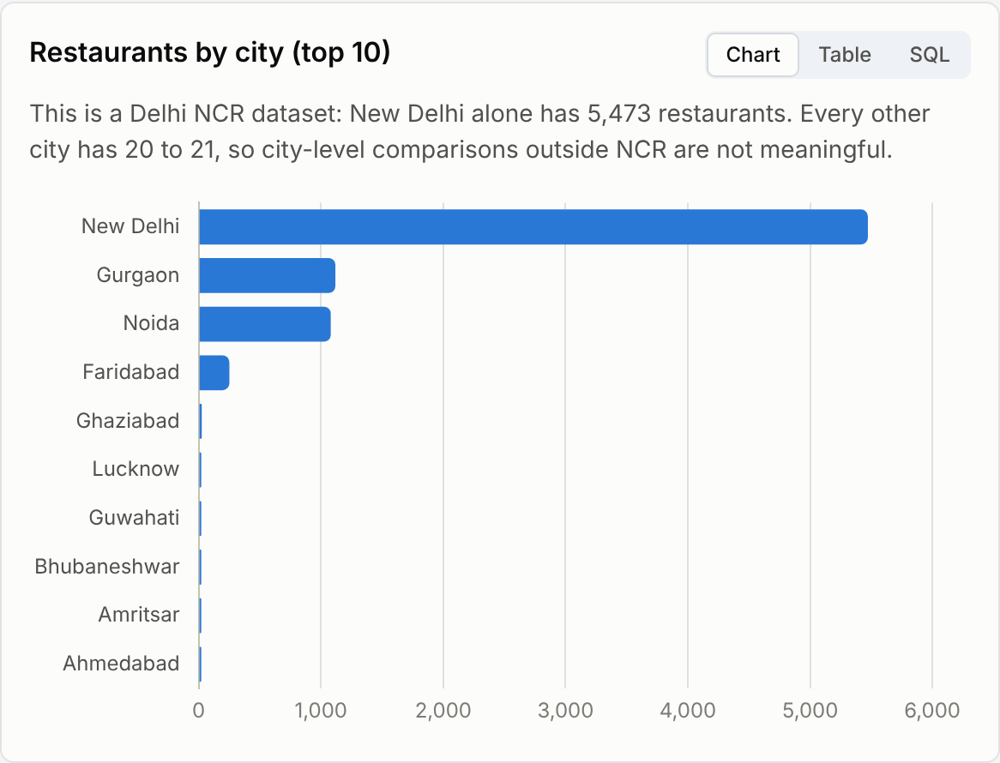
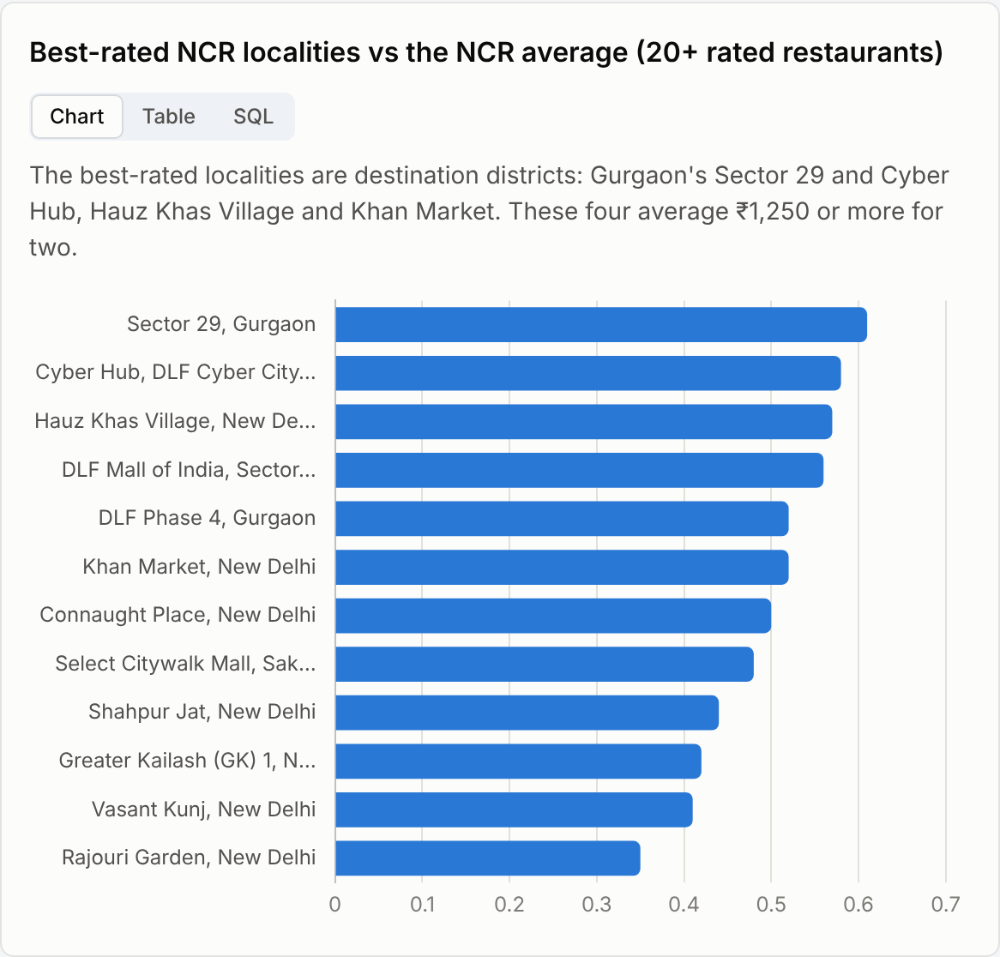
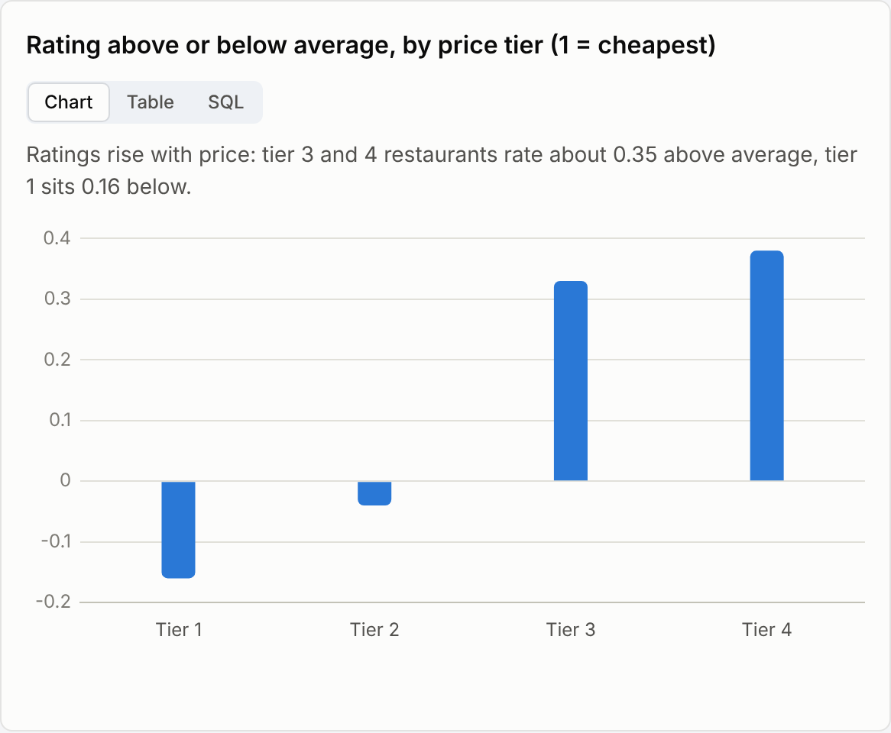
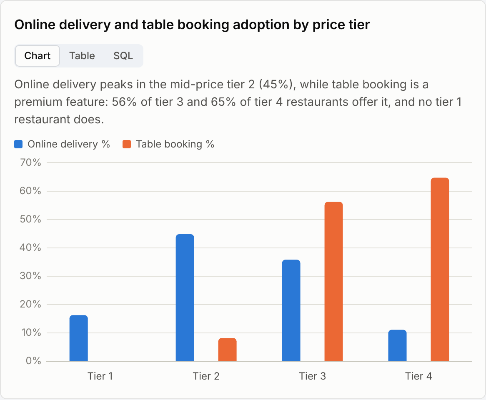
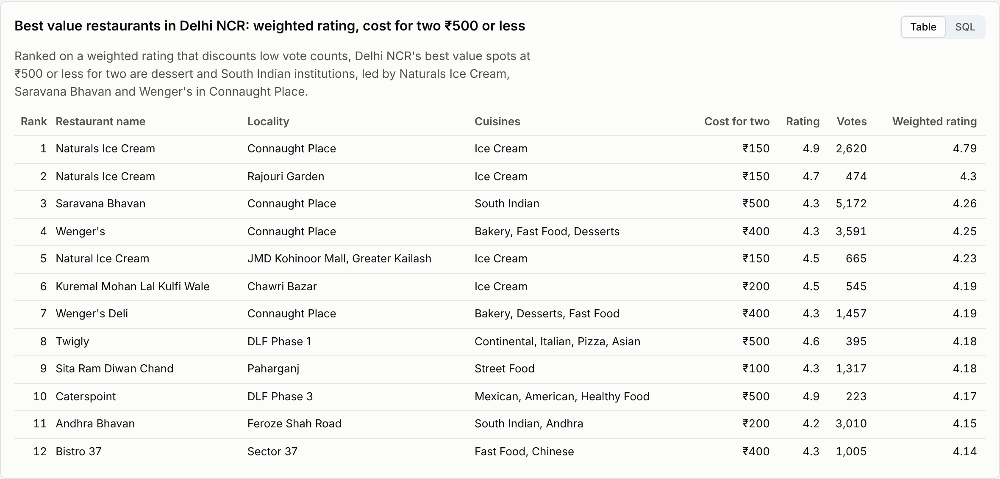

# Zomato Restaurant Deep Dive (SQL)

Price, quality and online delivery across 8,652 Indian restaurants on Zomato: which neighbourhoods, cuisines and price points earn the best ratings, and where value for money sits. Built in SQLite with a recursive CTE, window functions and a vote-weighted rating, with an interactive dashboard.

**[Open the live dashboard](https://malharpatel78.github.io/zomato-restaurant-sql-analysis/)**  ·  every chart has a SQL tab showing the exact query behind it.



## Business questions

1. What does the dataset actually cover, and can cities be compared fairly?
2. Which Delhi NCR neighbourhoods are densest, and which rate best?
3. Which cuisines beat the average rating?
4. Do pricier restaurants rate higher, and who offers online delivery and table booking?
5. Where are the best value restaurants, once ratings with few votes are discounted?

## Dataset

[Zomato Restaurants Data](https://www.kaggle.com/datasets/shrutimehta/zomato-restaurants-data) on Kaggle: 9,551 restaurants in 15 countries, of which 8,652 are in India. Fields include city, locality, cuisines, cost for two, price tier (1 to 4), online delivery, table booking, rating and votes. The raw file is in `data/zomato.csv`.

## Data cleaning

`sql/01_clean.sql` logs every fix in a `data_quality_log` table:

| Issue found | Rows | Fix |
|---|---:|---|
| Restaurants outside India (14 countries, other currencies) | 899 | Excluded |
| Unrated restaurants stored as a 1.0 rating with 0 to 3 votes | 2,139 | Rating set to NULL |
| Cost for two recorded as 0 | 9 | Set to NULL |
| Cuisines stored as a pipe list (`North Indian\| Mughlai`) | all | Recursive CTE to one row per cuisine |
| Locality names with pipe separators | all | Replaced with commas |

The rating fix matters most. Treated as real scores, the 2,139 placeholder ratings drag the India average from 3.35 to 2.77 and make new, cheap restaurants look like the worst in the country.

## Key findings

**1. This is a Delhi NCR dataset.** 92% of Indian restaurants are in New Delhi, Gurgaon, Noida, Faridabad and Ghaziabad. The other 38 cities have about 20 restaurants each, all rated and averaging 488 votes, which suggests a sample of each city's best-known places (average rating 3.94 vs 3.28 in NCR). City rankings across India would mislead, so the neighbourhood analysis uses NCR only.



**2. Destination districts rate best.** Connaught Place is the densest locality (122 restaurants) and rates 3.78. The top-rated localities, Gurgaon's Sector 29 and Cyber Hub, Hauz Khas Village and Khan Market, rate about 0.5 to 0.6 above the NCR average and cost ₹1,250 or more for two. Dense residential areas such as Shahdara and Mayur Vihar rate about 3.0.



**3. Common cuisines rate below average.** North Indian is on 46% of menus and Chinese on 31%, but both sit slightly below the average rating. European, Asian and Mexican restaurants rate about half a point above it.

**4. Price buys rating, and features follow price.** Tier 3 and 4 restaurants rate about 0.35 above average, tier 1 sits 0.16 below. Online delivery peaks in mid-price tier 2 (45% of restaurants) while table booking is a premium feature (65% of tier 4, none in tier 1). Within the same price tier, offering delivery makes almost no difference to ratings.





**5. Engagement and rating move together.** Restaurants with 1,000+ votes average 4.11, against 3.10 for those under 50 votes.

**6. Best value in Delhi NCR is desserts and South Indian.** Using a weighted rating (IMDb-style, discounting restaurants with few votes), the top spots at ₹500 or less for two include Naturals Ice Cream, Saravana Bhavan and Wenger's in Connaught Place. The large chains rate below average: Cafe Coffee Day and Subway 3.0, Domino's 2.93; Barbeque Nation is the exception at 4.35.



## Recommendations

- **Treat this data as Delhi NCR insight.** Any national expansion or city ranking needs a dataset with full coverage of other cities.
- **Focus on review volume for new restaurants.** A quarter of restaurants have no rating, and ratings climb with votes; prompts that turn orders into reviews give restaurants a fairer score.
- **Pitch table booking to tier 3 and 4 restaurants and delivery to tier 2.** Adoption already follows price, so these are the receptive segments for each product.
- **Use weighted ratings in any "best of" list.** A 4.9 from 20 votes should not outrank a 4.3 from 5,000.

## SQL techniques used

| Technique | Where |
|---|---|
| Recursive CTE to split pipe lists into rows | `restaurant_cuisines` in `01_clean.sql` |
| Weighted (Bayesian) rating with a parameter CTE | `best_value` |
| `RANK()`, `ROW_NUMBER()`, share of total with `SUM(COUNT(*)) OVER ()` | `best_value`, `overview`, `rating_labels` |
| Conditional aggregation `AVG(CASE WHEN ...)` for side-by-side comparison | `delivery_effect` |
| Benchmarks with `CROSS JOIN` and scalar subqueries | rating gap queries |
| Median without a MEDIAN function | `overview` |
| Data-driven labels with `CASE` | Zomato rating labels, vote bands |

## Repository structure

```
data/zomato.csv            raw Kaggle file
sql/01_clean.sql           profiling, cleaning, data quality log
sql/02_analysis.sql        16 analysis queries, each tagged with a title and insight
results/*.csv              output of every query
docs/index.html            interactive dashboard (GitHub Pages)
scripts/build.py           loads the CSV into SQLite, runs the SQL, builds the dashboard
images/                    dashboard screenshots used in this README
```

## How to run

```bash
pip install pandas
python scripts/build.py      # creates data/zomato.db, results/, docs/index.html
```

Or in DB Browser for SQLite: import `data/zomato.csv` as `zomato_raw`, then run `sql/01_clean.sql` and the queries in `sql/02_analysis.sql`.

## Resume line

> Analysed 8,652 Zomato restaurants in SQL (recursive CTE, window functions, weighted rating); corrected 2,139 placeholder ratings that understated the average by 0.6 points, and showed price tier and review volume, not online delivery, explain rating differences.

---
Malhar Patel · MS Marketing Analytics & Insights, Rutgers Business School · [LinkedIn](https://www.linkedin.com/in/malharpatel0911)
